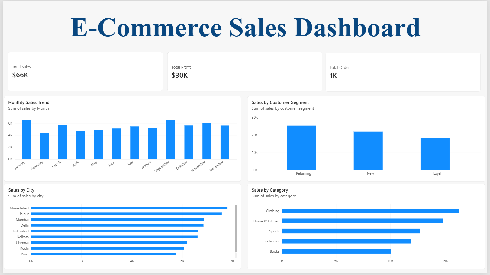

# E-Commerce Sales & Customer Analytics

## Project Overview

This project analyzes e-commerce sales data to understand sales performance, profitability, product categories, city-level performance, and customer segments.

The goal is to turn raw sales data into useful business insights using Python, SQL, and Power BI.

## Tools Used

- Python
- Pandas
- SQL
- SQLite
- Power BI
- DAX
- Excel-compatible CSV files

## Key Analysis Areas

- Overall sales, profit, and order performance
- Monthly sales trends
- Sales by product category
- Sales by city
- Sales by customer segment
- Order status analysis

## Dashboard Preview

The Power BI dashboard presents key sales and profitability metrics, monthly sales trends, category performance, city-level sales, and customer segment analysis.

## Project Structure

Ecommerce-Sales-Customer-Analytics/
├── data/
│   ├── raw/
│   └── processed/
├── database/
├── sql/
├── notebooks/
├── powerbi/
├── images/
├── reports/
├── load.py
├── run_sql.py
└── README.md

## Dashboard Preview

## Business Insights

- **Top Product Category:** Clothing generated the highest sales among the product categories.
- **Top City:** Ahmedabad recorded the highest sales among the cities analyzed.
- **Top Customer Segment:** Returning customers contributed the highest sales among the customer segments.
- **Monthly Sales Trends:** The monthly sales chart helps track changes in sales performance throughout 2025.

